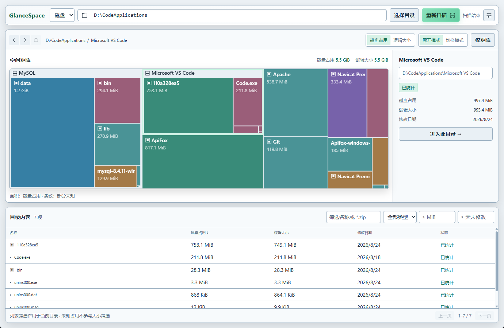
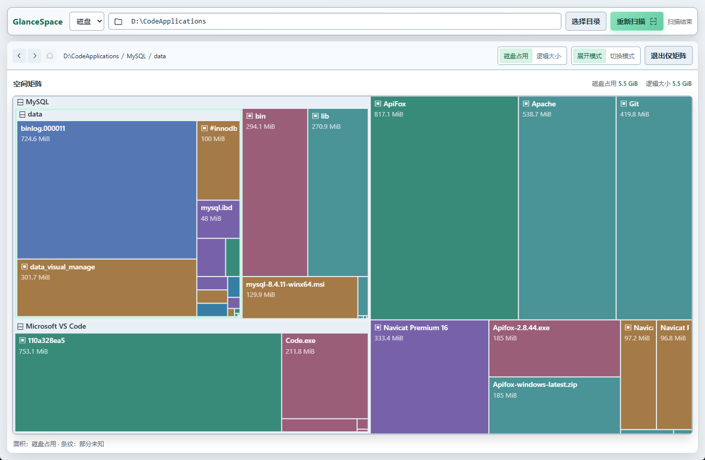

<div align="center">


# GlanceSpace

**Explore Windows disk usage with an interactive treemap**

Scan a local drive or folder to find the files and folders taking up the most space. Browse results as they appear. Scans read file system metadata only.

[Download](#download) · [Screenshots](#screenshots) · [Usage](#usage) · [Architecture](#architecture) · [Development](#development) · [Acknowledgments](#acknowledgments)

[简体中文](README.md) · **English**

</div>

---

## Download

| Platform | Installer |
| --- | --- |
| Windows 10 version 22H2 or Windows 11 (x64) | [GlanceSpace 0.1.0 · EXE installer](https://github.com/skahsd/GlanceSpace/releases/download/v0.1.0/GlanceSpace_0.1.0_x64-setup.exe) |

[View all releases](https://github.com/skahsd/GlanceSpace/releases)

## Screenshots

<p align="center">
  
  <br>
  <sub>Standard view · Click a folder in the treemap to see its contents in the list below.</sub>
</p>

<p align="center">
  
  <br>
  <sub>Treemap only mode · Hide the list and details while keeping the scan controls. Press Esc to return to the standard view.</sub>
</p>

## Features

- **See where the space goes.** Switch between size on disk and logical size to compare the space allocated by the file system with recorded file lengths.
- **Browse folders in the treemap.** Expand large folders in place or use Drill down mode to enter a folder. Filter the folder list by name, type, size, or days since modification.
- **Set up the view you prefer.** Pause, resume, or cancel scans. Right-click to use Windows Open with or locate an item in File Explorer. Choose between Chinese and English, two themes, and three text sizes. The light theme is the default.

## Usage

1. Run the installer and open GlanceSpace from the Start menu.
2. Choose a local fixed drive or a folder on it and click **Scan**.
3. Click a treemap item to see its details. Choose **Treemap only** when you want more room to explore.

Scans run with standard user permissions. GlanceSpace marks inaccessible items and sizes it cannot reliably measure, and skips the targets of symbolic links, junctions, and other reparse points.

## Architecture

| Part | Implementation |
| --- | --- |
| Windows desktop shell | Tauri 2 |
| Scanning and directory aggregation | Rust · `walkdir` |
| Interface | React · TypeScript · Vite |
| Treemap | Canvas 2D · `d3-hierarchy` |

## Development

You need Windows x64, Node.js 24+, the stable Rust MSVC toolchain, Visual Studio C++ Build Tools, and Microsoft Edge WebView2 Runtime. Run these commands from the repository root.

```powershell
npm ci
npm run desktop
```

Use `npm run dev` to preview the frontend. Disk scanning requires the desktop app.

```powershell
npm test
npm run build
cargo test --locked --manifest-path src-tauri/Cargo.toml
cargo clippy --locked --manifest-path src-tauri/Cargo.toml -- -D warnings
npm run desktop:build -- --debug
```

## Acknowledgments

- **Inspiration**
  - [SpaceSniffer](https://www.uderzo.it/main_products/space_sniffer/) inspired the interactive treemap.
  - [WizTree](https://diskanalyzer.com/) serves as a reference for scan performance.
- **Layout research** · [Squarified Treemaps](https://vanwijk.win.tue.nl/stm.pdf)
- **Key dependencies** · [Tauri](https://tauri.app/) · [`d3-hierarchy`](https://github.com/d3/d3-hierarchy) · [`walkdir`](https://github.com/BurntSushi/walkdir)
