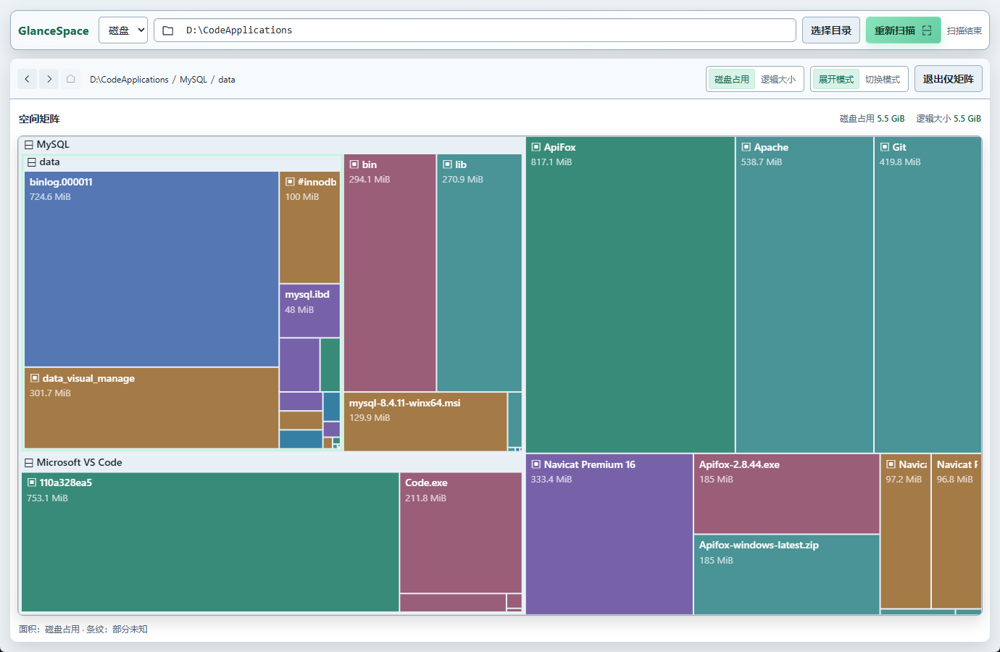

<div align="center">


# GlanceSpace

**用交互式空间矩阵查看 Windows 磁盘占用**

扫描本机磁盘或目录，快速找到占空间最多的文件和文件夹。支持边扫描边浏览，扫描只读取文件系统元数据。

[下载](#下载) · [界面预览](#界面预览) · [怎么用](#怎么用) · [架构](#架构) · [开发](#开发) · [致谢](#致谢)

**简体中文** · [English](README.en.md)

</div>

---

## 下载

| 适用平台 | 安装包 |
| --- | --- |
| Windows 10 22H2 或 Windows 11（x64） | [下载最新版 · EXE 安装程序](https://github.com/skahsd/GlanceSpace/releases/latest) |

[查看所有发布版本](https://github.com/skahsd/GlanceSpace/releases)

## 界面预览

<p align="center">
  
  <br>
  <sub>标准视图 · 点击矩阵中的目录，下方列表会显示该目录的内容。</sub>
</p>

<p align="center">
  
  <br>
  <sub>仅矩阵模式 · 隐藏列表和详情，保留扫描控件。按 Esc 恢复标准视图。</sub>
</p>

## 主要功能

- **看清空间用在哪。** 在磁盘占用和逻辑大小之间切换，分别查看文件系统分配的空间和文件长度。
- **跟着矩阵浏览目录。** 大目录可以原位展开，也可以用切换模式进入子目录。目录列表支持按名称、类型、大小和未修改天数筛选。
- **按自己的习惯使用。** 扫描可暂停、继续和取消。右键可调用 Windows「打开方式」或在资源管理器中定位项目。支持中英文、深浅主题和三档字号，默认使用浅色主题。

## 怎么用

1. 运行安装程序，从开始菜单打开 GlanceSpace。
2. 选择本机固定磁盘或其中的目录，点击「开始扫描」。
3. 点击空间矩阵中的项目查看详情。需要更多绘图空间时，点「仅矩阵」。

扫描以普通用户权限运行，会标记无法访问的条目和无法可靠统计的占用，并跳过符号链接、联接目录等重解析点的目标。

## 架构

| 部分 | 实现 |
| --- | --- |
| Windows 桌面壳 | Tauri 2 |
| 扫描与目录聚合 | Rust · `walkdir` |
| 界面 | React · TypeScript · Vite |
| 空间矩阵 | Canvas 2D · `d3-hierarchy` |

## 开发

需要 Windows x64、Node.js 24+、Rust stable MSVC 工具链、Visual Studio C++ Build Tools 和 Microsoft Edge WebView2 Runtime。在仓库根目录运行：

```powershell
npm ci
npm run desktop
```

`npm run dev` 可单独预览前端。访问本机磁盘需要运行桌面程序。

```powershell
npm test
npm run build
cargo test --locked --manifest-path src-tauri/Cargo.toml
cargo clippy --locked --manifest-path src-tauri/Cargo.toml -- -D warnings
npm run desktop:build -- --debug
```

## 致谢

- **灵感来源**
  - [SpaceSniffer](https://www.uderzo.it/main_products/space_sniffer/) 为交互式空间矩阵提供灵感。
  - [WizTree](https://diskanalyzer.com/) 是磁盘扫描的性能参考。
- **算法参考** · [Squarified Treemaps](https://vanwijk.win.tue.nl/stm.pdf)
- **主要依赖** · [Tauri](https://tauri.app/) · [`d3-hierarchy`](https://github.com/d3/d3-hierarchy) · [`walkdir`](https://github.com/BurntSushi/walkdir)
