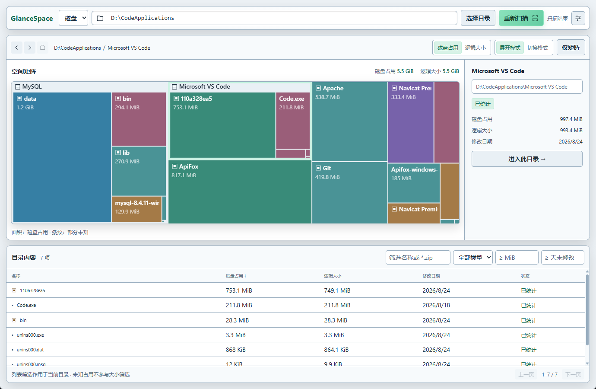

# GlanceSpace

**简体中文** · [English](README.en.md)

GlanceSpace 是一款 Windows 磁盘空间分析器。它用交互式空间矩阵展示文件和目录的大小，帮你快速找到占用空间最多的项目。

[下载 Windows x64 安装包](https://github.com/skahsd/GlanceSpace/releases/download/v0.1.0/GlanceSpace_0.1.0_x64-setup.exe) · [查看所有版本](https://github.com/skahsd/GlanceSpace/releases)

## 界面预览



**标准视图**。在空间矩阵里选中目录，下方列表会显示该目录的内容。


**仅矩阵模式**。隐藏列表和详情，保留扫描控件，把更多空间留给矩阵。按 `Esc` 可恢复标准视图。

## 主要功能

- 扫描本机固定磁盘及其目录，边扫描边浏览。支持暂停、继续和取消。
- 在 **磁盘占用** 和 **逻辑大小** 之间切换。前者反映文件系统实际分配的空间，后者反映文件记录的长度。
- 在矩阵中原位展开大目录，或使用切换模式进入子目录。目录列表支持按名称、类型、大小和未修改天数筛选。
- 从右键菜单调用 Windows 的「打开方式」，或在资源管理器中打开或定位项目。
- 支持简体中文和 English、深浅主题以及三档字号。首次启动默认使用浅色主题和标准字号。

## 安装与使用

1. 在 Windows 10 22H2 或 Windows 11（x64）上运行 `GlanceSpace_0.1.0_x64-setup.exe`。
2. 打开 GlanceSpace，选择本机固定磁盘或其中的目录，点击「开始扫描」。
3. 点击矩阵中的项目查看详情。展开目录后，可以继续点击子项查看空间分布。

扫描只读取文件系统元数据，以普通用户权限运行。无权访问的项目和无法可靠统计的占用会明确标记。扫描会跳过符号链接、联接目录等重解析点的目标。

## 从源码运行

需要 Windows x64、Node.js 24+、Rust stable MSVC 工具链、Visual Studio C++ Build Tools 和 Microsoft Edge WebView2 Runtime。

在仓库根目录运行：

```powershell
npm ci
npm run desktop
```

可用 `npm run dev` 单独预览前端。实际磁盘扫描需要桌面程序。

### 测试与构建

```powershell
npm test
npm run build
cargo test --locked --manifest-path src-tauri/Cargo.toml
cargo clippy --locked --manifest-path src-tauri/Cargo.toml -- -D warnings
npm run desktop:build -- --debug
```

`npm run desktop:build -- --debug` 生成调试程序。项目开发约定、验证记录和第三方声明见 [AGENTS.md](AGENTS.md)、[验证记录](docs/P0-VERIFICATION.md) 和 [D3 许可声明](THIRD-PARTY-D3-LICENSE.txt)。

## 致谢

- GlanceSpace 的空间矩阵浏览交互受到 SpaceSniffer 的启发。 [SpaceSniffer 官网](https://www.uderzo.it/main_products/space_sniffer/)
- 矩阵布局使用 `d3-hierarchy` 的 `treemapSquarify` 实现。 [D3 文档](https://d3js.org/d3-hierarchy/treemap#treemapSquarify)
- 布局算法源自 Mark Bruls、Kees Huizing 和 Jarke J. van Wijk 的研究。 [Squarified Treemaps](https://vanwijk.win.tue.nl/stm.pdf)
